# Taquilla, venta de entradas con servicios y RabbitMQ

[](https://github.com/DHat3r/entradas-soa/actions/workflows/ci.yml)

Venta de entradas para eventos, hecha con servicios independientes en Python que solo se comunican por RabbitMQ, y una web en React.

Contratos de mensajes, saga y estados: [docs/arquitectura.md](docs/arquitectura.md)

## Capturas

Hay dos sistemas en la misma web: clientes (`/`) e interno (`/interno`).

### Sistema de clientes

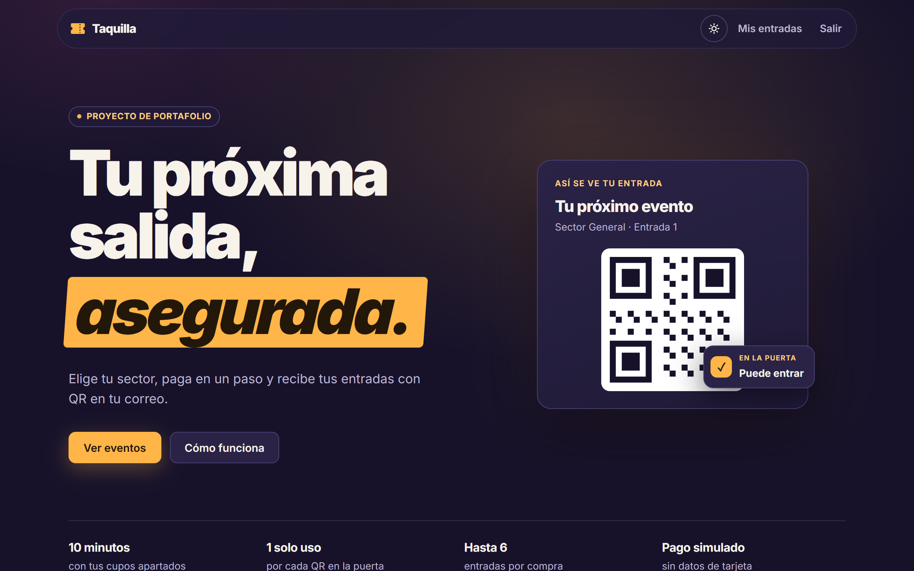
*Portada: qué ofrece y cómo se ve una entrada.*


*Próximos eventos: cada tarjeta tiene las muescas de una entrada de papel.*

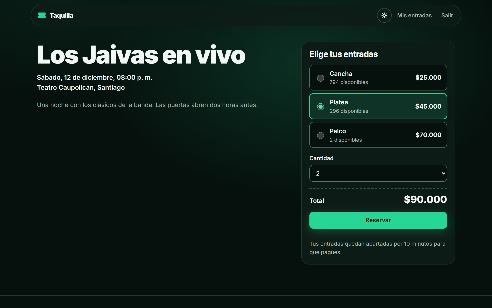
*Evento: el cliente elige sector y cantidad, y ve el total antes de reservar.*

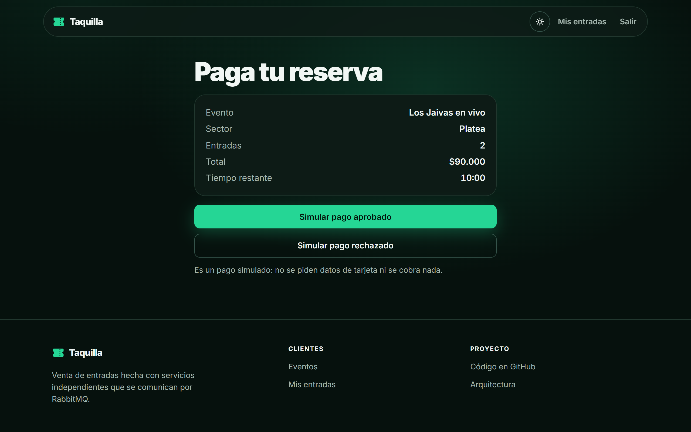
*Pago simulado: los cupos quedan apartados por 10 minutos.*

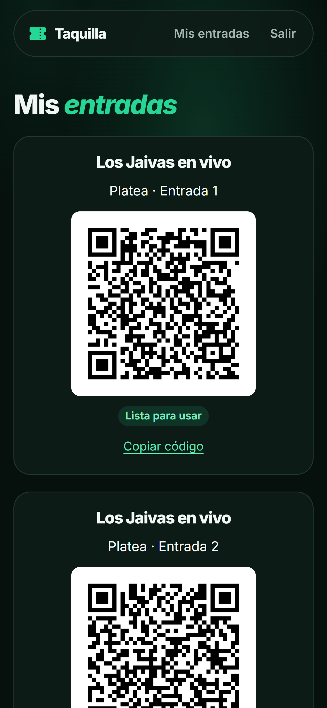

*Mis entradas en el celular: cada entrada tiene su QR y su estado.*

### Dos temas

La web sigue la preferencia del sistema operativo la primera vez, y después recuerda la que elijas con el botón de la cabecera.

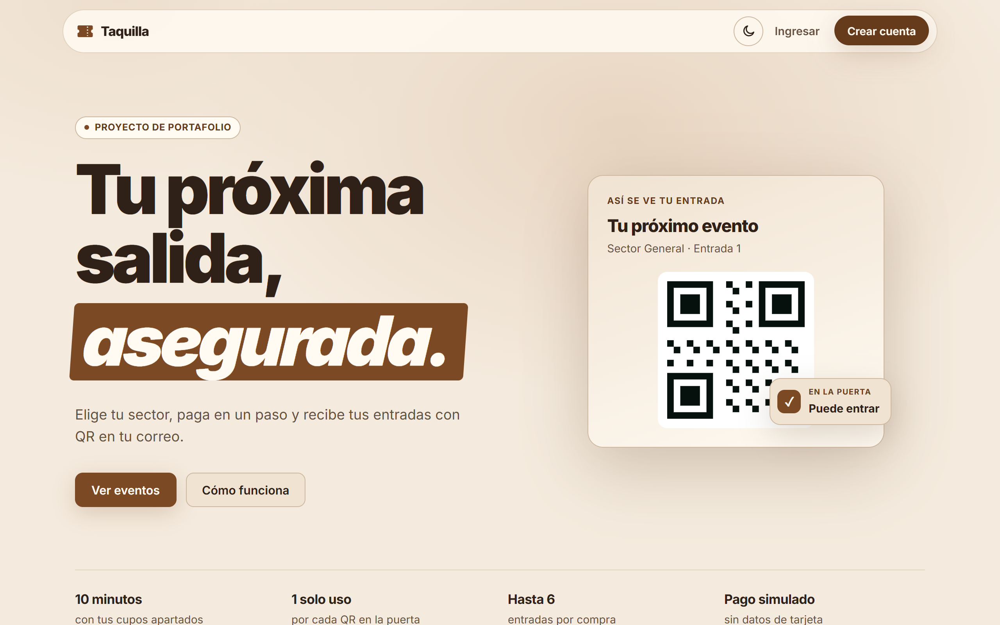
*Modo claro: café claro con blanco pastel.*

### Sistema interno

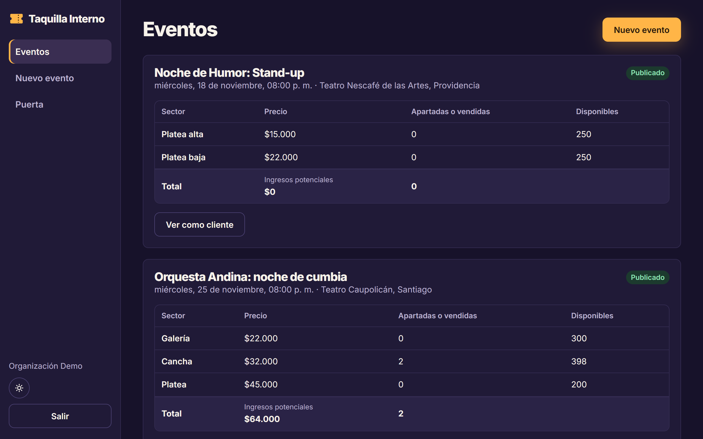
*Eventos: el organizador ve lo apartado o vendido por sector y los ingresos potenciales.*

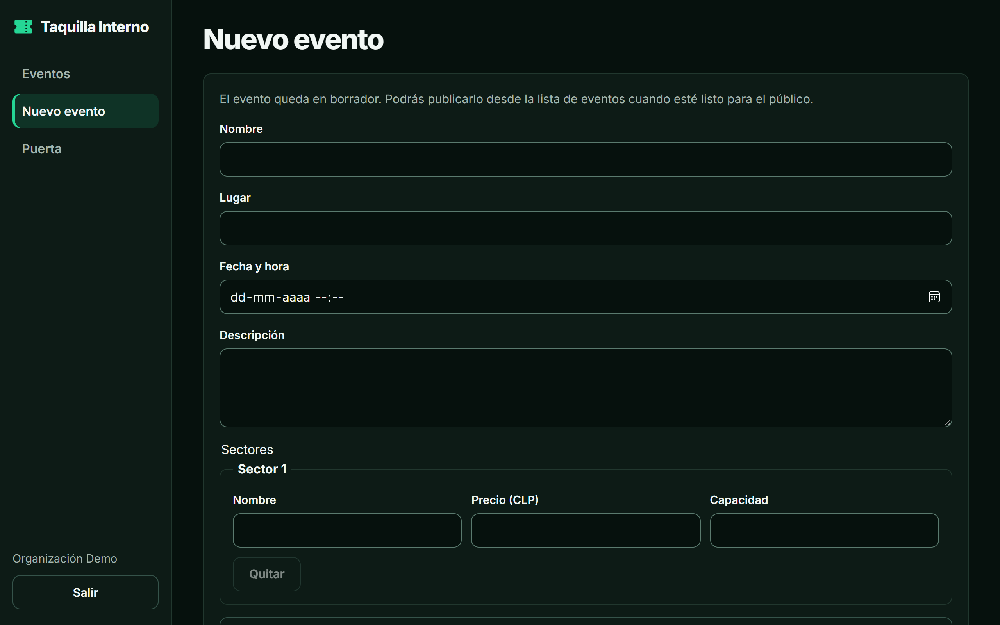
*Nuevo evento: se crea en borrador y se publica cuando está listo.*

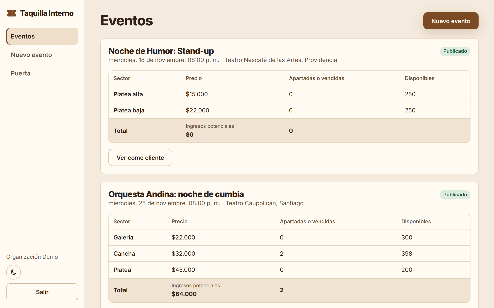
*El sistema interno también tiene modo claro.*

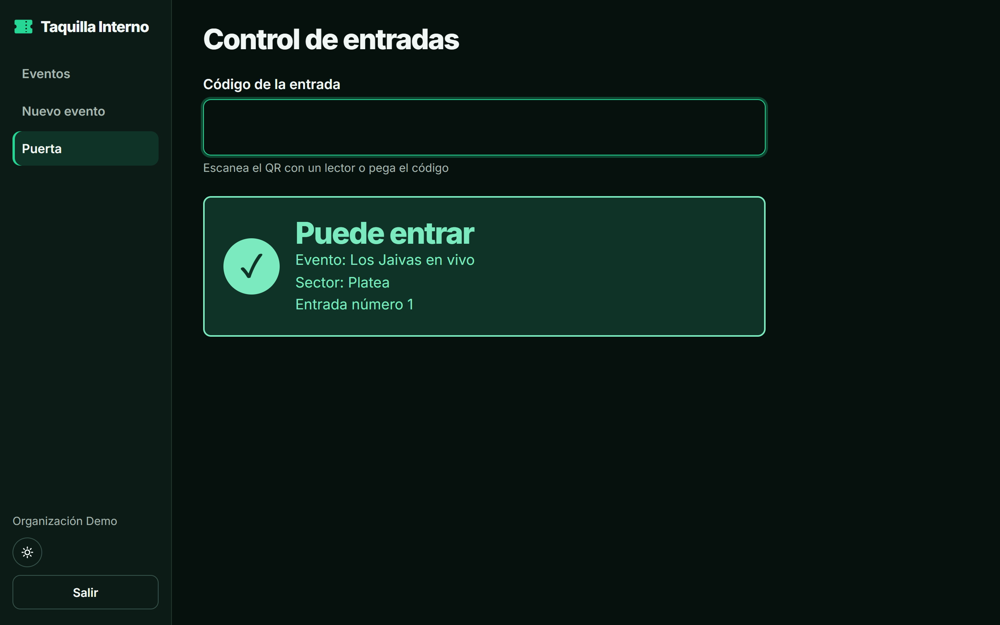
*Puerta: una entrada válida puede pasar.*

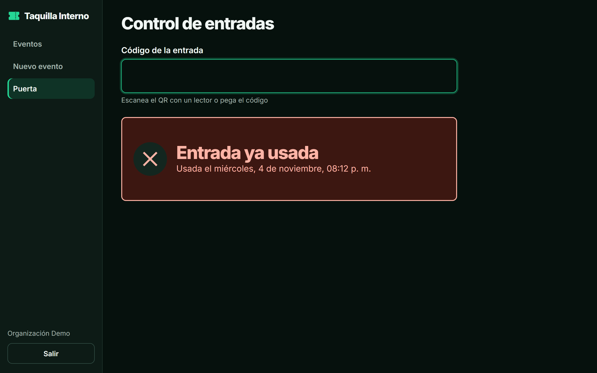
*Puerta: un QR ya usado se rechaza e indica cuándo se usó.*

## Demo

No hay despliegue público. Se corre en local con Docker Compose, según la sección [Cómo ejecutarlo](#cómo-ejecutarlo).

## Qué hace

**Flujo del cliente (`/`)**

- Ve los eventos publicados y el detalle de cada sector, con precio y cupos disponibles.
- Reserva de 1 a 6 entradas de un sector. La reserva aparta los cupos y tiene 10 minutos para pagarse.
- Paga con un pago simulado, que solo puede aprobarse o rechazarse.
- Recibe un correo con sus entradas y las ve en "Mis entradas".

**Flujo del equipo interno (`/interno`)**

- El organizador crea eventos con sectores, los publica y ve los cupos apartados o vendidos y los ingresos potenciales.
- El validador valida entradas en la puerta leyendo o pegando el código del QR. Una entrada válida solo entra una vez.

## Stack

| Capa | Tecnología |
|------|------------|
| Lenguaje y API | Python 3.14, FastAPI (solo en el gateway) |
| Mensajería | aio-pika, RabbitMQ 4 |
| Base de datos | PostgreSQL 17, SQLAlchemy 2 + Alembic |
| Seguridad | argon2 + JWT |
| Frontend | React 19 + TypeScript + Vite, servido por nginx |
| Correo de desarrollo | Mailpit |
| Infraestructura | Docker Compose, GitHub Actions |

## Cómo ejecutarlo

Necesitas Docker con Docker Compose.

```bash
git clone https://github.com/DHat3r/entradas-soa.git
cd entradas-soa
cp .env.example .env
docker compose up --build
```

Direcciones una vez levantado:

- Web: http://localhost:8080
- Sistema interno: http://localhost:8080/interno
- Swagger: http://localhost:8080/api/docs
- Correos (Mailpit): http://localhost:8025
- Panel de RabbitMQ: http://localhost:15672 (con `RABBITMQ_USER` y `RABBITMQ_PASSWORD` del `.env`)

Cuentas internas de demo: `organizador@entradas.dev` y `validador@entradas.dev`. La contraseña es la de `SEED_PASSWORD` en `.env.example` (`Demo1234!`).

La base parte vacía. Para ver el flujo de compra, entra como organizador, crea un evento y publícalo.

> **Advertencia:** los valores de `.env.example` son solo para desarrollo. Fuera de tu equipo cambia `JWT_SECRET`, `QR_SECRET`, las contraseñas de PostgreSQL y RabbitMQ, y `SEED_PASSWORD`. En local `COOKIE_SECURE` va en `false` porque no hay HTTPS; si el sitio se sirve con HTTPS, déjalo en `true`.

RabbitMQ y PostgreSQL guardan sus credenciales en sus volúmenes en el primer arranque. Si cambias esas contraseñas en `.env` después, recrea los volúmenes con `docker compose down -v`, lo que también borra los datos.

## Tests

Para los tests de Python hay que levantar PostgreSQL y RabbitMQ, porque algunas suites usan las dependencias reales:

```bash
docker compose -f docker-compose.yml -f docker-compose.dev.yml up -d --wait postgres rabbitmq
```

Crea el venv e instala las dependencias. Para cada servicio, reemplaza `services/<servicio>` por la carpeta que vayas a probar (por ejemplo `services/auth`):

```bash
python -m venv .venv
.venv\Scripts\activate        # en Linux o macOS: source .venv/bin/activate
pip install -r requirements-dev.txt -e libs/mensajeria -e libs/basedatos -r services/<servicio>/requirements.txt
```

Corre las suites de Python desde cada carpeta:

```bash
cd services/auth
python -m pytest
```

Frontend:

```bash
cd frontend
npm ci
npm test
```

E2E: recorre la compra completa por nginx, así que necesita todo el stack arriba. Crea eventos y usuarios de prueba en la base local.

```bash
docker compose up -d --build --wait
pip install pytest httpx
cd e2e
python -m pytest
```

El workflow `.github/workflows/ci.yml` corre el lint con ruff, los tests de cada carpeta, las migraciones (`alembic upgrade head` y `alembic check`), el frontend y el e2e.

Cantidad de tests por carpeta, contada con `python -m pytest --collect-only -q` y `npx vitest run`:

| Carpeta | Tests |
|---------|------:|
| `libs/mensajeria` | 11 |
| `services/auth` | 12 |
| `services/gateway` | 20 |
| `services/eventos` | 31 |
| `services/reservas` | 30 |
| `services/pagos` | 7 |
| `services/entradas` | 18 |
| `services/notificaciones` | 7 |
| **Subtotal Python** | **136** |
| `e2e` (necesita el stack) | 6 |
| `frontend` (Vitest) | 24 |
| **Total** | **166** |

`libs/basedatos` no tiene tests propios.

## Arquitectura

Servicios independientes que solo se hablan por RabbitMQ. El gateway es la única puerta HTTP, y cada servicio tiene su propio esquema en PostgreSQL.

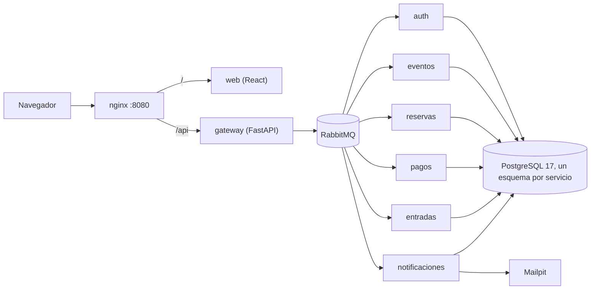

Diagrama resumido de la compra, copiado de [docs/arquitectura.md](docs/arquitectura.md):

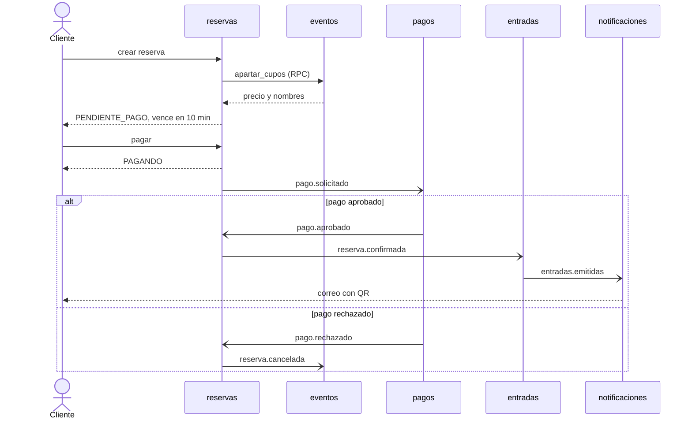

## Decisiones técnicas

- **RabbitMQ con pedir-responder y con eventos:** las acciones que necesitan respuesta, como el login o apartar cupos, usan pedir-responder con un plazo (5 segundos en el gateway y 3 para apartar cupos, para que `reservas` alcance a compensar). Los cambios de estado de la compra se publican como eventos, para que cada servicio reaccione sin acoplarse a los demás.
- **Saga en vez de transacción distribuida:** entre servicios no hay una transacción común. Cada paso confirma lo suyo, y si algo falla después, un paso compensatorio libera el cupo.
- **Descuento atómico de cupos:** el `UPDATE` solo descuenta si hay disponibles, así que no se puede vender de más. La prueba e2e lanza 50 compras simultáneas por 10 cupos contra el stack real y comprueba que solo 10 se aprueban.
- **Idempotencia de mensajes:** RabbitMQ entrega al menos una vez. Cada transición bloquea la fila y comprueba el estado esperado, y la tabla de apartados usa la reserva como clave primaria, así que un mensaje repetido no cambia nada.
- **`SELECT FOR UPDATE` en vez de un `UPDATE` condicionado:** en READ COMMITTED, un `UPDATE ... WHERE estado = 'PAGANDO'` no espera si la versión visible de la fila no cumple el filtro, y un pago que llegara antes del commit se perdería. Un test lo reproduce.
- **Reintentos con espera y reparación:** un fallo pasajero no agota los intentos en milisegundos, y una tarea reenvía los pasos atascados, porque cada consumidor tolera repetirlos.
- **Publicar antes del commit:** si publicar falla, la transacción se revierte y RabbitMQ reintenta. El límite es que, si el proceso cae entre publicar y confirmar, el evento ya salió y el estado no cambió (no hay *outbox*).
- **Gateway delgado y permisos en cada servicio:** el gateway valida el JWT y traduce HTTP a mensajes. Cada servicio vuelve a exigir el rol de la acción, así que no depende solo de la puerta.
- **Cookie `httpOnly` y `SameSite=Strict`:** JavaScript no puede leer la sesión y el navegador no la envía desde otros sitios. La web y la API comparten origen gracias al proxy de nginx.
- **QR firmado con HMAC:** un código inventado o alterado se rechaza sin consultar la base.
- **Precio calculado por el servidor:** el cliente no envía montos. `reservas` usa el precio que devuelve `eventos`.
- **Un esquema por servicio en una sola base:** simplifica el entorno local. Es un compromiso frente a una base por servicio: los servicios no comparten tablas, pero sí una misma instancia de PostgreSQL.

## Límites conocidos

- **Sin *outbox*.** Si un servicio cae justo después de publicar y antes del commit, el evento ya salió pero el estado no cambió. Al procesar un mensaje entrante se recupera solo. En `pagar` no: la reserva sigue pendiente y el cupo se libera al vencer.
- **Sin cola de mensajes fallidos.** Al décimo intento, un evento se descarta y solo queda en el log. La reparación recupera el pago, la emisión y la liberación de cupos, pero el correo no se reenvía: el cliente ve sus entradas en "Mis entradas".
- **Sin límite de reservas por cliente.** Alguien podría apartar cupos una y otra vez sin pagar; cada reserva se limita a 6 entradas y vence en 10 minutos.
- **Límite de intentos de login y registro en memoria.** Vale por instancia del gateway y se reinicia con ella.
- **El registro revela qué correos existen.** Responde 409 si el correo ya está.
- **Pago simulado.** No hay pasarela real ni reembolsos.
- **Validación sin separar por evento.** Un validador puede validar entradas de cualquier evento, y un organizador también las de eventos ajenos. El código del QR garantiza que la entrada es auténtica, no que sea de ese evento.

## Qué mejoraría con más tiempo

- *Outbox* para publicar eventos sin perderlos si el servicio cae.
- Cola de mensajes fallidos, para no perder los que agotan sus reintentos.
- Una base de datos por servicio.
- Límite de reservas por cliente.
- Escáner de QR con cámara en la puerta.
- Datos de demo al arrancar, para no empezar con la base vacía.
- Despliegue público.
- Trazas entre servicios.

## Origen

Este proyecto nace de `SCG-SOA`, un control de gastos hecho en equipo en un ramo de Arquitectura de Software de la universidad, con un bus TCP. Aquí se cambió el dominio, se reemplazó el bus por RabbitMQ y Supabase por un stack local. No reutiliza el código de ese proyecto.

## Autor

Leandro · [GitHub](https://github.com/DHat3r)
