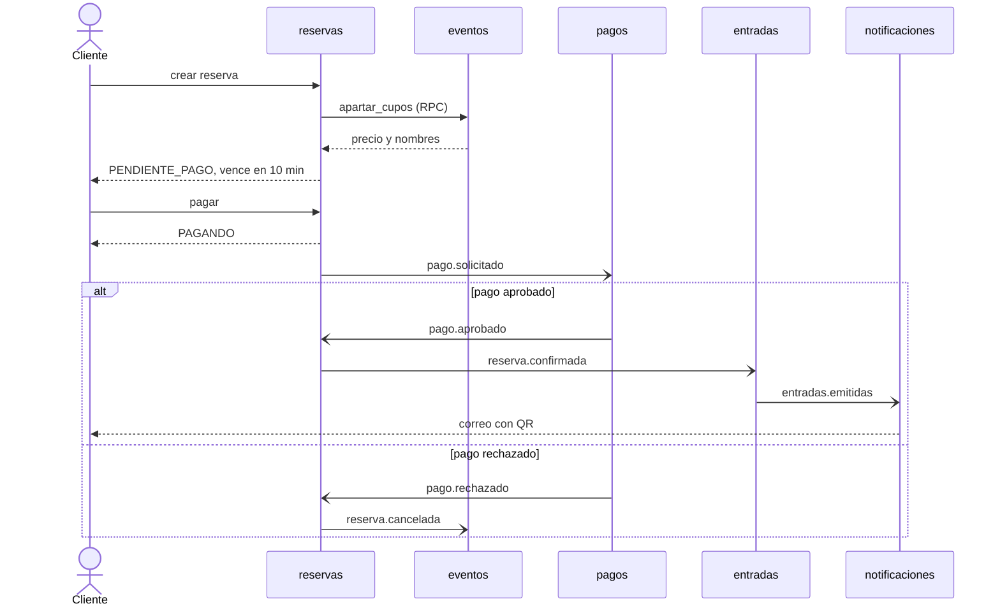
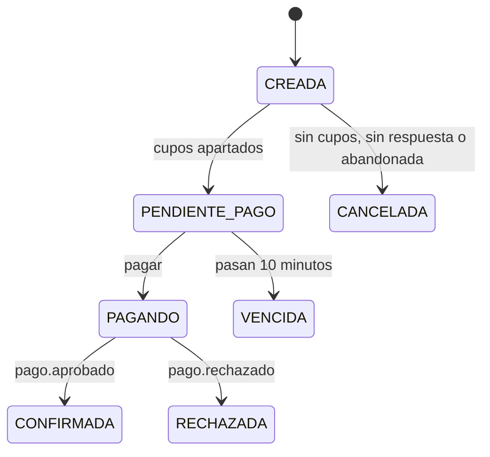

# Arquitectura

Venta de entradas construida como servicios independientes que solo se hablan por RabbitMQ.
Este documento es el contrato: si un mensaje cambia, se cambia primero aquí.

## Piezas

| Pieza | Responsabilidad | Esquema en PostgreSQL |
|---|---|---|
| `gateway` | Única puerta HTTP. Valida la sesión y traduce HTTP a mensajes | ninguno |
| `auth` | Usuarios, contraseñas, roles y emisión de JWT | `auth` |
| `eventos` | Eventos, sectores y cupos disponibles | `eventos` |
| `reservas` | Reservas y coordinación de la saga de compra | `reservas` |
| `pagos` | Pago simulado | `pagos` |
| `entradas` | Emisión de entradas con QR firmado y validación en la puerta | `entradas` |
| `notificaciones` | Correo con las entradas | `notificaciones` |
| `frontend` | App React con dos sistemas: clientes (`/`) e interno (`/interno`) | ninguno |

Hay una sola instancia de PostgreSQL, pero cada servicio usa solo su esquema: ninguno lee las
tablas de otro. Si necesita un dato ajeno, lo pide por mensaje o guarda una copia al recibirlo.

## Roles

| Rol | Cómo se crea | Puede |
|---|---|---|
| `cliente` | Registro público | Comprar y ver sus entradas |
| `organizador` | Seed | Crear y publicar eventos, ver sus ventas y validar entradas |
| `validador` | Seed | Solo validar entradas en la puerta |

El gateway valida el JWT y agrega la identidad al mensaje. Los servicios confían en esa identidad
porque RabbitMQ no publica su puerto AMQP fuera de la red de Docker. Su panel web sí queda abierto
en `127.0.0.1` para revisar colas: quien tenga acceso a esa máquina y a sus credenciales podría publicar
mensajes con una identidad falsa, así que en producción habría que cerrarlo. Ningún servicio acepta un
`usuario_id` que venga del cuerpo de la petición.

## Formatos de mensaje

### Pedir-responder

Cola durable `rpc.<servicio>`. El cliente usa `reply_to` y `correlation_id`, y espera 5 segundos.

```json
{"accion": "crear", "identidad": {"usuario_id": "uuid", "rol": "cliente", "correo": "a@b.cl"}, "datos": {}}
```

`identidad` es `null` en las acciones públicas. Las respuestas son una de estas dos:

```json
{"ok": true, "datos": {}}
{"ok": false, "error": {"codigo": "conflicto", "mensaje": "Texto para el usuario"}}
```

| `codigo` | HTTP |
|---|---|
| `validacion` | 422 |
| `no_autorizado` | 401 |
| `prohibido` | 403 |
| `no_encontrado` | 404 |
| `conflicto` | 409 |
| Demasiados intentos de login o registro (`demasiados_intentos`, lo responde el gateway) | 429 |
| `no_disponible` | 503 |
| Sin respuesta en 5 s | 504 |

Un error inesperado responde `{"codigo": "interno"}` (HTTP 500) sin detalles: el detalle queda en
el log del servicio.

### Eventos

Exchange durable `entradas.eventos` de tipo `topic`. Cada servicio consume desde una cola quorum
`<servicio>.eventos`. Si un consumidor falla, espera (1, 2, 4... hasta 30 s) y republica el mensaje
con el encabezado `x-intentos`; al décimo intento lo descarta y lo deja en el log. La cuenta es propia
porque `x-delivery-limit` no cuenta los `nack` con `requeue` en RabbitMQ 4.

```json
{"id": "uuid", "tipo": "reserva.confirmada", "ocurrido_en": "2026-11-04T12:00:00Z", "datos": {}}
```

Se publican con *publisher confirms* y como persistentes. La entrega es **al menos una vez**, así
que todo consumidor debe ser idempotente.

## Acciones

| Servicio | Acción | Quién | Datos | Devuelve |
|---|---|---|---|---|
| auth | `registrar` | público | `nombre, correo, password` | usuario |
| auth | `login` | público | `correo, password` | `token`, usuario |
| eventos | `listar_publicados` | público | | eventos con sectores |
| eventos | `detalle` | público | `evento_id` | evento con sectores |
| eventos | `crear` | organizador | `nombre, descripcion, lugar, fecha, sectores[{nombre, precio_clp, capacidad}]` | evento en borrador |
| eventos | `publicar` | organizador dueño | `evento_id` | evento |
| eventos | `listar_mios` | organizador | | eventos con cupos vendidos |
| eventos | `apartar_cupos` | interno (`reservas`) | `reserva_id, sector_id, cantidad` | `evento_id, evento_nombre, sector_nombre, precio_clp` |
| reservas | `crear` | cliente | `sector_id, cantidad` (1 a 6) | reserva |
| reservas | `pagar` | cliente dueño | `reserva_id, resultado_simulado` (`aprobar` o `rechazar`) | reserva en `PAGANDO` |
| reservas | `detalle` | cliente dueño | `reserva_id` | reserva |
| reservas | `listar_mias` | cliente | | reservas |
| entradas | `listar_mias` | cliente | | entradas con QR |
| entradas | `validar` | organizador, validador | `codigo` | resultado y datos de la entrada |

## Saga de compra

`reservas` coordina. No hay transacción entre servicios: cada paso confirma lo suyo y, si algo falla
después, se deshace con un paso compensatorio (liberar el cupo).



### Estados de una reserva



Las transiciones que reaccionan a un mensaje bloquean la fila con `SELECT ... FOR UPDATE`, comprueban
el estado esperado y recién ahí lo cambian. Si el estado ya es otro, otro proceso hizo la transición y el mensaje se ignora. Así se
resuelven los mensajes repetidos.

No sirve un `UPDATE ... WHERE estado = 'PAGANDO'`: en READ COMMITTED, si la versión visible de la fila
no cumple el `WHERE`, PostgreSQL no espera el bloqueo y afecta 0 filas, y un pago que llegara antes del
commit de `pagar` se perdería.

La carrera entre pagar y vencer se resuelve con `vence_en`: `pagar` exige que el plazo siga vigente y
el vencimiento solo toma reservas con el plazo cumplido, saltando con `SKIP LOCKED` las filas ocupadas.

Una reserva en `PAGANDO` no vence, así que no puede llegar un pago aprobado sobre una reserva ya
liberada.

### Reparación

Si un mensaje agota sus intentos o el broker pierde datos, una reserva podría quedar detenida. Cada
30 segundos, `reservas` busca las que llevan más de 2 minutos en `PAGANDO`, en `CONFIRMADA` sin que haya
llegado `entradas.emitidas`, o canceladas sin que haya llegado `cupos.liberados`, y reenvía el paso.
Repetir es seguro: `pagos` conserva su resultado, `entradas` no emite dos veces, `notificaciones` no
reenvía el correo y `eventos` no libera dos veces.

### Eventos publicados

| Tipo | Publica | Consume | Datos |
|---|---|---|---|
| `pago.solicitado` | reservas | pagos | `reserva_id, monto_clp, resultado_simulado` |
| `pago.aprobado` | pagos | reservas | `reserva_id, pago_id` |
| `pago.rechazado` | pagos | reservas | `reserva_id, pago_id` |
| `reserva.confirmada` | reservas | entradas | `reserva_id, cliente_id, cliente_correo, evento_id, evento_nombre, sector_nombre, cantidad` |
| `reserva.cancelada` | reservas | eventos | `reserva_id, sector_id, motivo` (`rechazada`, `vencida`, `error`, `reintento`) |
| `cupos.liberados` | eventos | reservas | `reserva_id` |
| `entradas.emitidas` | entradas | notificaciones, reservas | `reserva_id, cliente_correo, evento_nombre, sector_nombre, entradas[{id, codigo}]` |

## Reglas que no se pueden romper

**No sobrevender.** El descuento es atómico, en la misma transacción que registra el apartado:

```sql
UPDATE sectores SET disponibles = disponibles - :n WHERE id = :id AND disponibles >= :n;
```

Si no afecta filas, no hay cupos. Leer y luego escribir permitiría que dos compras vieran el mismo cupo.

**Liberar una sola vez.** La tabla `apartados` (`reserva_id` como clave primaria) hace idempotentes las
dos operaciones: apartar dos veces la misma reserva no descuenta de nuevo, y liberar solo suma si
`liberado` pasa de falso a verdadero. Si la cancelación llega antes que un `apartar_cupos` atrasado,
deja un apartado ya liberado y sin cantidad, y ese pedido se rechaza.

**Publicar antes del commit.** Cada transición de la saga publica su evento dentro de la transacción.
Si publicar falla, se revierte y RabbitMQ reintenta. Si la respuesta llega antes del commit, su
`SELECT ... FOR UPDATE` espera el bloqueo de la fila y luego lee el estado nuevo.

**Códigos estables.** El id de una entrada se deriva de la reserva y su número. Si el commit falla
después de publicar, la reentrega genera los mismos códigos y el QR que ya salió por correo sigue
siendo válido.

**El precio lo pone el servidor.** `reservas` calcula el monto con el precio que devuelve `eventos`.
Los montos son enteros en pesos chilenos.

**Una entrada entra una vez.** `UNIQUE (reserva_id, numero)` evita emitir dos veces. La validación es
`UPDATE entradas SET usada_en = now() WHERE id = :id AND usada_en IS NULL`. El código del QR lleva una
firma HMAC, así que un código inventado o alterado se rechaza sin ir a la base.

**Sin datos de tarjeta.** El pago es simulado y solo recibe `aprobar` o `rechazar`.

## Sesión

El gateway guarda el JWT en una cookie `httpOnly` con `SameSite=Strict`: JavaScript no puede leerla
(protege de XSS) y el navegador no la envía desde otros sitios (protege de CSRF). También acepta
`Authorization: Bearer` para clientes que no son navegadores. El token no viaja en el cuerpo de la
respuesta de login: esos clientes lo toman de la cabecera `Set-Cookie`. La web y la API comparten
origen porque nginx hace de proxy de `/api`.

## Límites conocidos

- **Sin *outbox*.** Si un servicio cae justo después de publicar y antes del commit, el evento ya
  salió pero el estado no cambió. Al procesar un mensaje entrante se recupera solo, porque RabbitMQ
  lo reentrega. En `pagar` no: la reserva sigue pendiente, el resultado del pago se ignora y el cupo
  se libera al vencer. `pagos` conserva ese resultado, así que un nuevo intento de pagar esa reserva
  recibe el mismo.
- **Sin límite de reservas por cliente.** Alguien podría apartar cupos una y otra vez sin pagar;
  cada reserva se limita a 6 entradas y vence en 10 minutos.
- **Sin cola de mensajes fallidos.** Al décimo intento, un evento se descarta y solo queda en el log.
  La reparación recupera el pago, la emisión y la liberación de cupos. Si se descarta `entradas.emitidas`,
  el correo no se reenvía, pero el cliente ve sus entradas en "Mis entradas".
- **Límite de intentos de login y registro en memoria.** Vale por instancia del gateway y se reinicia
  con ella.
- **El registro revela qué correos existen.** Responde 409 si el correo ya está; el login sí responde
  igual en ambos casos.
- **Pago simulado.** No hay pasarela real ni reembolsos.
- **Validación sin separar por evento.** Un validador puede validar entradas de cualquier evento, y un organizador también las de eventos ajenos. El código del QR garantiza que la entrada es auténtica, no que sea de ese evento.
